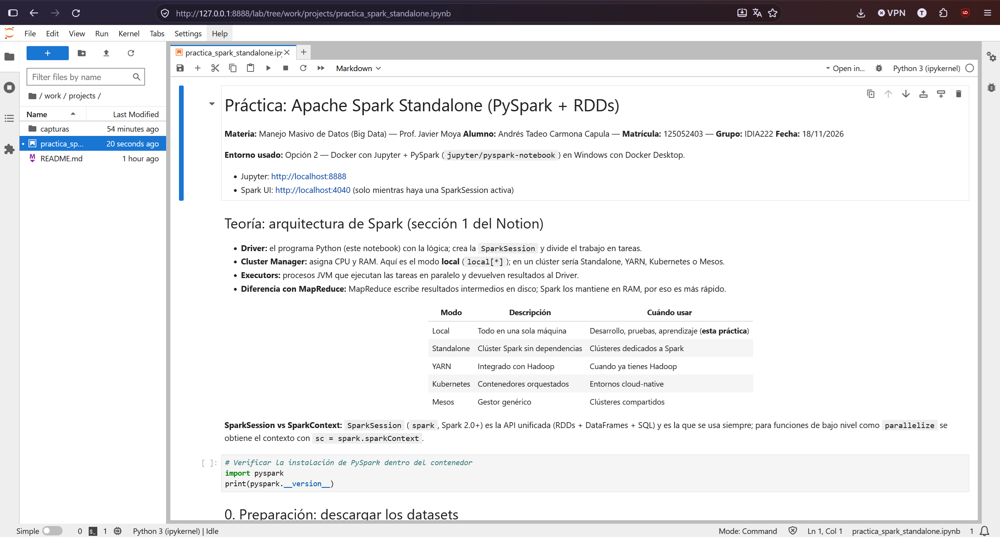
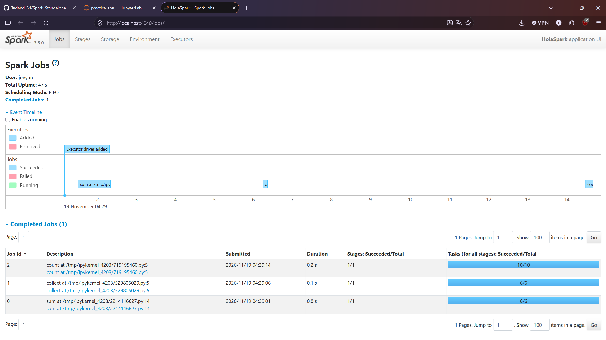
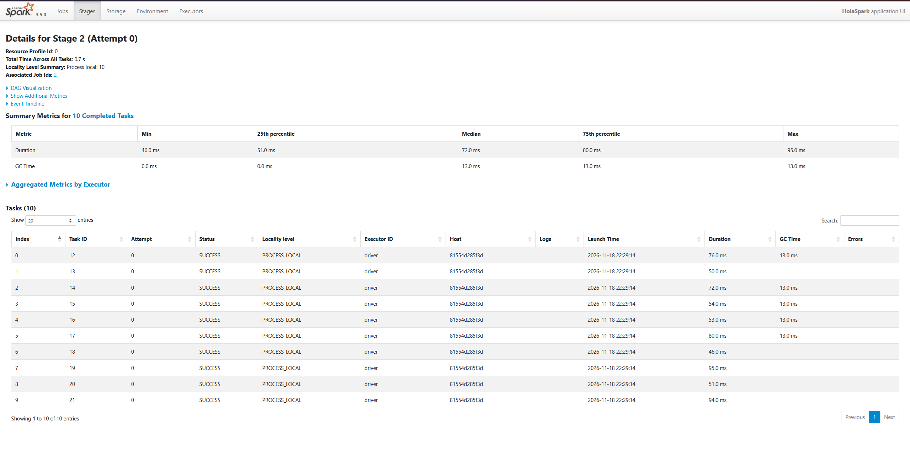
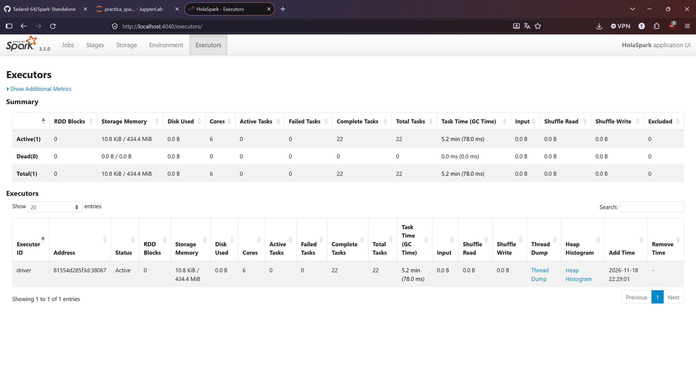
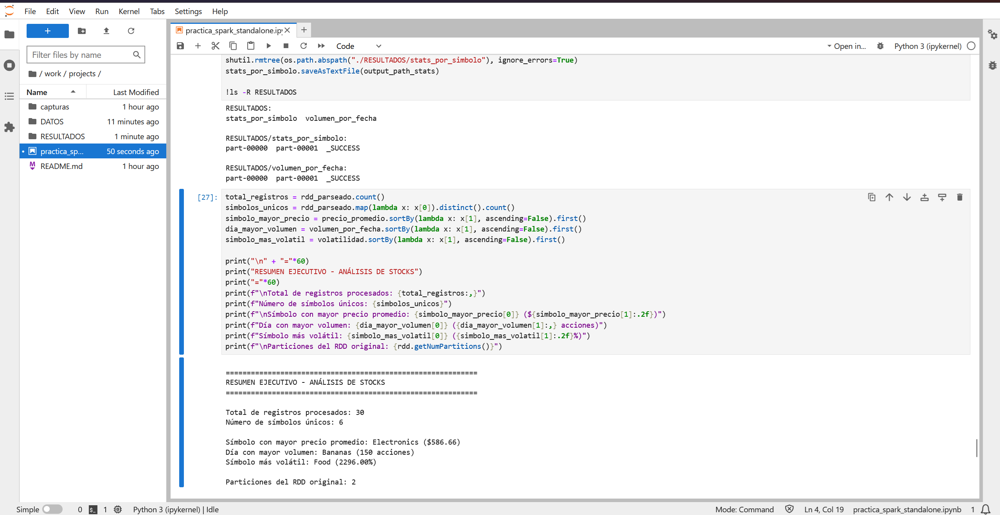

# Práctica: Apache Spark Standalone (PySpark + RDDs)

**Materia:** Manejo Masivo de Datos (Big Data) — Prof. Javier Moya
**Alumno:** Andrés Tadeo Carmona Capula · **Matrícula:** 125052403 · **Grupo:** IDIA222

Guía completa para reproducir la práctica desde cero en **Windows con Docker Desktop**, aunque nunca hayas usado Spark.

---

## Índice
1. [Objetivo](#1-objetivo)
2. [Requisitos previos](#2-requisitos-previos)
3. [Elección del entorno](#3-elección-del-entorno)
4. [Paso a paso](#4-paso-a-paso)
5. [Qué contiene el notebook](#5-qué-contiene-el-notebook)
6. [Resultados esperados](#6-resultados-esperados)
7. [Nota sobre los datasets](#7-nota-sobre-los-datasets)
8. [Capturas](#8-capturas)
9. [Subir el repositorio a GitHub](#9-subir-el-repositorio-a-github)
10. [Solución de problemas](#10-solución-de-problemas)
11. [Cobertura de la práctica](#11-cobertura-de-la-práctica)
12. [Estructura del repositorio](#12-estructura-del-repositorio)

---

## 1. Objetivo
Montar un entorno de Apache Spark y practicar:
- Su arquitectura: Driver, Cluster Manager y Executors.
- `SparkSession` y `SparkContext`, con configuración personalizada.
- RDDs: transformaciones (`map`, `filter`, `reduceByKey`, `aggregateByKey`, `sortBy`), acciones (`count`, `take`, `sum`, `collect`) y *lazy evaluation*.
- Lectura de archivos locales (`file://`) y escritura con `saveAsTextFile`.
- Monitorización con la Spark UI.
- Un proyecto de análisis de datos con un resumen ejecutivo.

## 2. Requisitos previos
| Herramienta | Para qué | Cómo comprobarla |
|---|---|---|
| Docker Desktop (con WSL 2) | Ejecutar el contenedor con Spark y Jupyter | `docker --version` |
| Git | Subir la práctica a GitHub | `git --version` |
| Navegador web | Abrir Jupyter y la Spark UI | — |
| Cuenta de GitHub | Entregar el repositorio | — |

> No hace falta instalar Python, Java ni Spark en Windows: todo viene dentro de la imagen de Docker.

## 3. Elección del entorno
El Notion ofrece tres opciones:

| Opción | Ventajas | Inconvenientes en Windows |
|---|---|---|
| 1. BDA Lab | Hadoop + HDFS + Spark | Requiere bash (`menu.sh`), WSL o Git Bash, y es pesado |
| **2. Docker + Jupyter** ✅ | Un solo comando, Jupyter listo, sin configuración | No tiene HDFS (solo archivos locales) |
| 3. Instalación local con pip | Sin Docker | Exige Java, `JAVA_HOME` y `winutils.exe`, y suele fallar |

**Se eligió la opción 2.** Todos los ejercicios y el proyecto usan archivos locales; HDFS solo aparece en la sección 7 del Notion, que es para el entorno BDA Lab y aquí se documenta como teoría.

## 4. Paso a paso

### 4.1 Iniciar Docker Desktop
Abre Docker Desktop y espera a que indique **Engine running**. En PowerShell, comprueba que responde:
```powershell
docker --version
```

### 4.2 Crear la carpeta de trabajo
```powershell
mkdir spark-local
cd spark-local
```
- `mkdir` crea la carpeta donde vivirá toda la práctica.
- `cd` entra en ella. Todo lo que el contenedor guarde aquí lo verás también en Windows.

### 4.3 Levantar el contenedor de Jupyter + PySpark
Comando original del Notion (para Linux/macOS):
```bash
docker run -it -p 8888:8888 -p 4040:4040 \
  -v $(pwd):/home/jovyan/work/projects/ \
  jupyter/pyspark-notebook
```
Versión para **PowerShell**: `$(pwd)` se escribe `${PWD}` y el `\` para partir la línea no existe, así que va en una sola línea:
```powershell
docker run -it -p 8888:8888 -p 4040:4040 -v ${PWD}:/home/jovyan/work/projects/ jupyter/pyspark-notebook
```
En **CMD** sería: `docker run -it -p 8888:8888 -p 4040:4040 -v %cd%:/home/jovyan/work/projects/ jupyter/pyspark-notebook`

| Parte | Qué hace |
|---|---|
| `docker run` | Descarga la imagen la primera vez (1–2 GB) y crea el contenedor |
| `-it` | Modo interactivo: ves los mensajes y lo detienes con `Ctrl + C` |
| `-p 8888:8888` | Publica Jupyter en `http://localhost:8888` |
| `-p 4040:4040` | Publica la Spark UI en `http://localhost:4040` |
| `-v ${PWD}:/home/jovyan/work/projects/` | Conecta tu carpeta de Windows con `work/projects` del contenedor, para no perder el trabajo |
| `jupyter/pyspark-notebook` | La imagen: Python, Java, Spark 3.5 y Jupyter |

> Si Docker Desktop pide permiso para compartir la carpeta, acéptalo.

### 4.4 Abrir Jupyter
En la consola aparece una línea parecida a:
```
http://127.0.0.1:8888/lab?token=4f1c2b...
```
Cópiala **completa, con el token**, en el navegador.

### 4.5 Poner el notebook en la carpeta correcta
1. Copia `practica_spark_standalone.ipynb` dentro de `spark-local` (en Windows).
2. En Jupyter, entra a **work → projects** y abre el notebook.

> ⚠️ Trabaja siempre dentro de `work/projects`. Un archivo creado en otra carpeta del contenedor se pierde al borrarlo.

### 4.6 Ejecutar el notebook
1. Escribe tu nombre, matrícula y grupo en la primera celda.
2. Ejecuta las celdas **en orden**, una por una, con `Shift + Enter`.
3. La celda **0** descarga los datasets con `wget`. Ejecútala **solo una vez**; si se repite, crea copias `.1`.
4. Cuando veas el aviso 📸, abre `http://localhost:4040` y toma las capturas **antes** de seguir: la Spark UI desaparece al ejecutar `spark.stop()`.
5. Al final, revisa que todas las celdas tengan su salida y guarda con `Ctrl + S`.

### 4.7 Detener y reanudar
- Para detener: `Ctrl + C` en la consola (confirma con `y`).
- Para reanudar otro día: entra en `spark-local` y repite el `docker run` del paso 4.3. Tus archivos siguen ahí porque están en tu carpeta de Windows.

## 5. Qué contiene el notebook
| Sección | Contenido |
|---|---|
| Teoría | Arquitectura, modos de ejecución, SparkSession vs SparkContext, versión de PySpark |
| 0 | Creación de `DATOS/` y `RESULTADOS/` y descarga de los 3 datasets |
| 1 | SparkSession básica y con configuración personalizada; `spark.conf.set` |
| 2 | "Hola Spark": suma de 0 a 100, particiones y *lazy evaluation* |
| 3 | Spark UI: RDD de 1 millón de números en 10 particiones |
| 4 | Análisis de ventas (`pdi_sales_small.csv`): ruta `file://`, split doble frente a split único, quitar el encabezado, `reduceByKey`, versión con DataFrame |
| 5 | Conexión con HDFS (teoría) |
| 6 | Tabla de errores comunes y soluciones |
| Ejercicios 1–7 | SparkSession personalizada, operaciones con RDD, `map`/`filter`, clave-valor, CSV, optimización de `split`, depuración |
| Proyecto (pasos 1–6) | Carga, parseo con `try/except`, estadísticas con `aggregateByKey`, top 10, volatilidad, guardado y resumen ejecutivo |
| Reflexión | Respuestas a las 6 preguntas |

## 6. Resultados esperados
**Ejercicios**
| Ejercicio | Resultado |
|---|---|
| 1 | App `MiPrimerAnalisis`, `spark.executor.memory = 1g`, `shuffle.partitions = 8` |
| 2 | 20 elementos · primeros 5: `[1, 2, 3, 4, 5]` · suma 210 · máximo 20, mínimo 1 |
| 3 | 34 números mayores a 50 · primeros 10: `[51, 54, …, 78]` |
| 4 | Laptop 3600, Mouse 55, Teclado 75 · ventas: 3 / 2 / 1 · mayor: Laptop (3600) |
| 5 | 10 personas mayores de 30 (ver sección 7) |
| 6 | Código con un único `split()` y explicación |
| 7 | Los 4 errores identificados y el código corregido |

**Proyecto**
| Métrica | Resultado |
|---|---|
| Registros procesados | 30 |
| Símbolos (categorías) únicos | 6 |
| Mayor precio promedio | Electronics ($586.66) |
| Mayor volumen | Bananas (150) |
| Más volátil | Food (2296.00%) |
| Más estable | Accessories (20.01%) |

Archivos generados: `RESULTADOS/volumen_por_fecha/part-0000*` y `RESULTADOS/stats_por_simbolo/part-0000*`.

## 7. Nota sobre los datasets
Los archivos reales de https://github.com/josepgarcia/datos no coinciden con lo que describe el enunciado:
- **`persons.csv`** tiene las columnas `name,age,gender,salary` (20 personas), no `name,age,city`. Por eso el ejercicio 5 da **10 personas** mayores de 30 en lugar de 2. En el ejercicio 6, la tercera columna es `gender`.
- **`stocks.txt`** es un inventario `id,name,category,quantity,price` (30 registros), no `Símbolo,Fecha,Precio,Volumen`. Para mantener la estructura del proyecto se usó esta equivalencia:

| Enunciado | Columna real |
|---|---|
| símbolo | `category` |
| fecha | `name` (producto) |
| precio | `price` |
| volumen | `quantity` |

## 8. Capturas
Guárdalas en la carpeta `capturas/` con estos nombres (o cambia las rutas de abajo):
1. `01_jupyter.png`: Jupyter con el notebook abierto en `work/projects`.
2. `02_sparkui_jobs.png`: Spark UI, pestaña **Jobs**.
3. `03_sparkui_stages.png`: pestaña **Stages** (ejemplo con 10 tasks).
4. `04_sparkui_executors.png`: pestaña **Executors**.
5. `05_resumen.png`: salida del resumen ejecutivo del proyecto.







## 9. Subir el repositorio a GitHub
1. En github.com crea un repositorio **vacío** (sin README) llamado `practica-spark-standalone`.
2. Detén el contenedor (`Ctrl + C`) y, en PowerShell dentro de `spark-local`, ejecuta:
```powershell
git init
git add .
git commit -m "Práctica Spark Standalone"
git branch -M main
git remote add origin https://github.com/TU_USUARIO/practica-spark-standalone.git
git push -u origin main
```
| Comando | Qué hace |
|---|---|
| `git init` | Convierte la carpeta en un repositorio |
| `git add .` | Prepara todos los archivos; `.gitignore` excluye `.crc` y los checkpoints |
| `git commit -m` | Guarda una versión con un mensaje |
| `git branch -M main` | Nombra la rama `main` |
| `git remote add origin` | Enlaza la carpeta con el repositorio de GitHub |
| `git push -u origin main` | Sube los archivos |

**PDF opcional:** en Jupyter ve a *File → Save and Export Notebook As → HTML*, ábrelo en el navegador y elige *Imprimir → Guardar como PDF*.

## 10. Solución de problemas
| Problema | Solución |
|---|---|
| `docker: command not found` o error de conexión | Abre Docker Desktop y espera a **Engine running** |
| `port is already allocated` (8888 o 4040) | Otro contenedor usa el puerto: `docker ps` y luego `docker stop <id>` |
| Jupyter pide contraseña o token | Copia la URL completa con `?token=` desde la consola |
| No veo mis archivos en Jupyter | Entra a `work/projects`; revisa que ejecutaste `docker run` desde `spark-local` |
| `FileNotFoundException` | Ejecuta la celda 0 y usa la ruta `file://` + `os.path.abspath(...)` |
| `Output directory ... already exists` | La celda del paso 6 ya borra la carpeta; vuelve a ejecutarla |
| `Port 4040 is already in use` | `spark.stop()`, o bien `.config("spark.ui.port", "4041")` |
| La Spark UI no abre | Solo existe mientras hay una SparkSession activa; ejecuta una celda de Spark primero |
| La configuración de la sesión no cambia | `getOrCreate()` reutiliza la sesión; detenla antes (el notebook ya lo hace) |

## 11. Cobertura de la práctica
| Sección del Notion | Dónde se cubre |
|---|---|
| Introducción a Spark | Teoría del notebook y este README |
| 1. Arquitectura y modos de ejecución | Celda de teoría |
| 2. Entornos de desarrollo | Sección 3 de este README (opción 2) y verificación de PySpark |
| 3. SparkSession vs SparkContext (básica, personalizada, `spark.conf.set`) | Sección 1 del notebook |
| 4. Hola Spark + lazy evaluation | Sección 2 |
| 5. Spark UI | Sección 3 + capturas |
| 6. Lectura de datos (pasos 1–6 de ventas + DataFrame) | Sección 4 |
| 7. Conexión con HDFS | Sección 5 (teoría: el entorno elegido no incluye HDFS) |
| 8. Finalizar sesión | `spark.stop()` en el ejercicio 7 y en el proyecto |
| Errores comunes | Sección 6 del notebook y sección 10 de este README |
| Ejercicios 1–7 | Notebook, sección de ejercicios |
| Proyecto pasos 1–6 | Notebook, sección del proyecto |
| Preguntas de reflexión | Final del notebook |

## 12. Estructura del repositorio
```
spark-local/
├── practica_spark_standalone.ipynb   # Notebook ejecutado, con salidas
├── README.md                         # Esta guía
├── .gitignore
├── DATOS/                            # pdi_sales_small.csv, persons.csv, stocks.txt
├── RESULTADOS/                       # volumen_por_fecha/, stats_por_simbolo/
└── capturas/                         # Capturas de Jupyter y de la Spark UI
```
